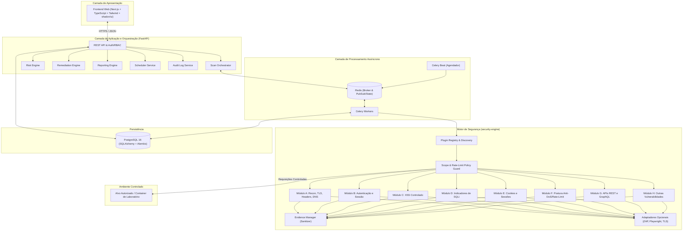

# ARCHITECTURE.md — Arquitetura Técnica do Sistema (`cyber-security-checker`)

Este documento descreve a arquitetura distribuída, os componentes de domínio, o modelo de dados relacional, os contratos de integração e os fluxos de execução da plataforma `cyber-security-checker`.

---

## 1. Visão Geral da Arquitetura

O `cyber-security-checker` adota uma arquitetura modular orientada a domínios, desacoplando a interface web, a API de gerenciamento/orquestração, a fila de processamento assíncrono e o motor modular de verificação de segurança (`security-engine`).

---

## 2. Componentes Principais e Responsabilidades

| Componente | Diretório Principal | Responsabilidade |
| :--- | :--- | :--- |
| **Frontend (SOC UI)** | `frontend/` | Painel web estilo Security Operations Center (SOC), dashboards em tempo real, gestão de ativos, assistente de auditoria, triagem de vulnerabilidades e exportação de relatórios. |
| **API Backend** | `backend/app/api/` | Autenticação JWT/Cookie seguro, RBAC multi-organização, validação Pydantic v2, endpoints RESTful versionados (`/api/v1`) e health checks. |
| **Scan Orchestrator** | `backend/app/services/orchestrator.py` | Valida escopo e autorização do ativo, aplica perfil de scan (`Quick`, `Standard`, `API`, etc.), despacha tarefas para os workers, monitora progresso, processa cancelamentos e consolida resultados. |
| **Security Engine** | `security-engine/security_engine/` | Pacote Python independente e extensível baseado em plugins (`BaseSecurityScanner`). Executa verificações passivas e ativas de baixo impacto sob supervisão do `ScopePolicyValidator`. |
| **Evidence Manager** | `security-engine/security_engine/core/evidence.py` | Captura trechos de requisição/resposta, certificados e cabeçalhos, sanitizando segredos, tokens e cookies sensíveis antes da persistência. |
| **Risk Engine** | `security-engine/security_engine/core/risk.py` | Calcula severidade padronizada (`CRITICAL`, `HIGH`, `MEDIUM`, `LOW`, `INFO`), grau de confiança (`CERTAIN`, `FIRM`, `TENTATIVE`), vetores CVSS 4.0 quando fundamentados e score de risco do ativo (0–100). |
| **Remediation Engine** | `security-engine/security_engine/core/remediation.py` | Base de conhecimento estruturada e versionada com orientações técnicas de correção passo a passo, exemplos seguros multi-stack (Python, Node.js, Nginx, Apache, etc.) e procedimentos de validação. |
| **Reporting Engine** | `backend/app/services/reporting.py` | Gera relatórios executivos, técnicos e comparativos nos formatos JSON, CSV, HTML e PDF com evidências sanitizadas. |
| **Worker & Scheduler** | `workers/` | Workers Celery dedicados à execução assíncrona isolada das auditorias e Celery Beat para agendamentos recorrentes. |
| **Audit Log** | `backend/app/services/audit_log.py` | Trilha imutável de auditoria registrando logins, cadastros de ativos, validações de escopo, início/cancelamento de scans e exportações. |

---

## 3. Modelo de Dados Relacional (PostgreSQL)

As tabelas principais do banco de dados são gerenciadas via SQLAlchemy 2.0 e migrações Alembic:

1. **`organizations`**:
   - `id` (UUID, PK), `name`, `slug` (Unique), `is_active`, `created_at`, `updated_at`.
2. **`users`**:
   - `id` (UUID, PK), `email` (Unique), `hashed_password`, `full_name`, `is_active`, `created_at`, `updated_at`.
3. **`organization_memberships`**:
   - `id` (UUID, PK), `organization_id` (FK), `user_id` (FK), `role` (`ADMIN`, `SECURITY_ANALYST`, `DEVELOPER`, `VIEWER`), `created_at`.
4. **`assets`** (Sistemas / Alvos cadastrados):
   - `id` (UUID, PK), `organization_id` (FK), `name`, `target_url`, `hostname`, `asset_type` (`WEB_APP`, `REST_API`, `GRAPHQL_API`, `DOMAIN`), `environment` (`PRODUCTION`, `STAGING`, `DEVELOPMENT`, `LAB`), `owner_name`, `owner_email`, `tags` (JSONB), `excluded_paths` (JSONB), `risk_score` (Integer), `authorization_status` (`PENDING`, `VERIFIED`, `EXPIRED`, `REVOKED`), `created_at`, `updated_at`.
5. **`target_authorizations`** (Comprovação de autorização):
   - `id` (UUID, PK), `asset_id` (FK), `organization_id` (FK), `method` (`DNS_TXT`, `HTTP_WELL_KNOWN`, `LAB_INTERNAL`), `verification_token`, `status` (`PENDING`, `VERIFIED`, `EXPIRED`, `REVOKED`), `verified_by_user_id` (FK), `scope_notes`, `verified_at`, `expires_at`, `created_at`.
6. **`scan_profiles`** (Perfis e templates de auditoria):
   - `id` (UUID, PK), `name`, `slug`, `profile_type` (`QUICK`, `STANDARD`, `AUTHENTICATED`, `API`, `DEEP_ASSESSMENT`, `CUSTOM`), `enabled_modules` (JSONB), `policy_config` (JSONB), `allow_in_production` (Boolean).
7. **`scans`** (Execuções de auditoria):
   - `id` (UUID, PK), `organization_id` (FK), `asset_id` (FK), `initiated_by_user_id` (FK), `profile_type`, `status` (`PENDING`, `QUEUED`, `RUNNING`, `COMPLETED`, `CANCELLED`, `FAILED`, `ABORTED_TARGET_DEGRADED`), `progress_percent` (Integer), `current_module`, `enabled_modules` (JSONB), `policy_snapshot` (JSONB), `total_checks_run` (Integer), `findings_summary` (JSONB), `error_message`, `celery_task_id`, `started_at`, `completed_at`, `created_at`.
8. **`scan_check_results`** (Resultado de cada verificação individual, incluindo aprovados/erros):
   - `id` (UUID, PK), `scan_id` (FK), `module_id`, `check_id`, `title`, `status` (`PASSED`, `VULNERABILITY`, `POTENTIAL_VULNERABILITY`, `INCONCLUSIVE`, `NOT_APPLICABLE`, `EXECUTION_ERROR`), `duration_ms`, `details` (JSONB), `created_at`.
9. **`findings`** (Vulnerabilidades e potenciais vulnerabilidades identificadas):
   - `id` (UUID, PK), `organization_id` (FK), `asset_id` (FK), `scan_id` (FK), `fingerprint` (Hash determinístico para rastreamento entre scans), `module_id`, `check_id`, `title`, `description`, `category`, `result_classification` (`VULNERABILITY`, `POTENTIAL_VULNERABILITY`), `severity` (`CRITICAL`, `HIGH`, `MEDIUM`, `LOW`, `INFO`), `confidence` (`CERTAIN`, `FIRM`, `TENTATIVE`), `cvss_v4_vector`, `cvss_v4_score`, `cwe_ids` (JSONB), `owasp_categories` (JSONB), `affected_endpoint`, `evidence` (JSONB sanitizado), `impact`, `reproduction_steps`, `remediation_data` (JSONB), `treatment_status` (`OPEN`, `IN_PROGRESS`, `MITIGATED`, `ACCEPTED_RISK`, `FALSE_POSITIVE`, `RESOLVED_VERIFIED`), `assigned_to_user_id` (FK), `first_detected_at`, `last_confirmed_at`, `resolved_at`.
10. **`scan_schedules`** (Agendamentos recorrentes):
    - `id` (UUID, PK), `organization_id` (FK), `asset_id` (FK), `profile_type`, `cron_expression`, `is_active`, `last_run_at`, `next_run_at`, `created_by_user_id` (FK), `created_at`.
11. **`audit_logs`** (Trilha de auditoria interna):
    - `id` (UUID, PK), `organization_id` (FK, nullable), `user_id` (FK, nullable), `action`, `resource_type`, `resource_id`, `ip_address`, `metadata_json` (JSONB), `created_at`.

---

## 4. Contrato Padronizado do Motor de Segurança (`security-engine`)

Todo módulo de verificação no `security-engine` implementa a interface abstrata `BaseSecurityModule`:

### 4.1 Metadados do Módulo (`ModuleMetadata`)
- `module_id`: Identificador único (ex.: `mod_a_recon_headers_tls`, `mod_e_cookies_session`).
- `name`: Nome legível em português.
- `category`: Categoria principal (ex.: `Configuração de Segurança`, `Autenticação`, `Cookies e Sessões`).
- `impact_level`: `PASSIVE` | `LOW_IMPACT_ACTIVE` | `CONTROLLED_ASSESSMENT`.
- `owasp_refs`: Referências OWASP Top 10 / ASVS 5.0 / WSTG.
- `cwe_refs`: Lista de CWEs cobertos.
- `supported_asset_types`: Tipos de ativos compatíveis (`WEB_APP`, `REST_API`, `GRAPHQL_API`, `DOMAIN`).

### 4.2 Contexto de Execução (`ScanExecutionContext`)
Recebido pelo módulo no momento da execução:
- `scan_id`: UUID da auditoria.
- `target_url`: URL base canônica validada.
- `hostname`: Host extraído e validado.
- `environment`: Ambiente do ativo (`PRODUCTION`, `STAGING`, `DEVELOPMENT`, `LAB`).
- `policy`: Instância de `ScanExecutionPolicy` (limites de rate limit, timeout, max bytes, caminhos excluídos).
- `http_client`: Cliente HTTP seguro encapsulado (`ScopedSafeHttpClient`) que aplica *throttling*, validação de escopo em redirecionamentos, limite de bytes e *circuit breaker*.
- `cancellation_check`: Callback (`Callable[[], bool]`) para interromper imediatamente a execução caso o usuário solicite cancelamento.

### 4.3 Saída Padronizada (`ModuleExecutionResult`)
Retorna:
- `module_id`: Identificador do módulo.
- `checks`: Lista de `CheckEvaluationResult` (cada verificação individual com status `PASSED`, `VULNERABILITY`, `POTENTIAL_VULNERABILITY`, `INCONCLUSIVE`, `NOT_APPLICABLE`, `EXECUTION_ERROR`).
- `findings`: Lista de `NormalizedFinding` contendo evidências já sanitizadas pelo `EvidenceManager` e enriquecidas pelo `RemediationEngine` e `RiskEngine`.
- `metrics`: Tempo de execução (`duration_ms`), total de requisições realizadas e erros operacionais capturados.

---

## 5. Comunicação e Topologia de Containers (Docker Compose)

| Serviço | Imagem / Build | Porta Interna | Porta Host Padrão | Dependências e Healthcheck |
| :--- | :--- | :--- | :--- | :--- |
| `postgres` | `postgres:16-alpine` | `5432` | `${POSTGRES_PORT:-5432}` | `pg_isready -U postgres -d cybersecuritychecker` |
| `redis` | `redis:7-alpine` | `6379` | `${REDIS_PORT:-6379}` | `redis-cli ping` |
| `backend` | `./backend` (inclui `security-engine`) | `8000` | `${BACKEND_PORT:-8000}` | Depende de `postgres` e `redis` saudáveis; expõe `GET /api/v1/health` |
| `worker` | `./backend` (comando Celery Worker) | N/A | N/A | Depende de `postgres`, `redis` e `backend`; healthcheck via `celery inspect ping` ou processo ativo |
| `frontend` | `./frontend` (Next.js) | `3000` | `${FRONTEND_PORT:-3000}` | Depende de `backend`; expõe interface web e `/api/health` |
